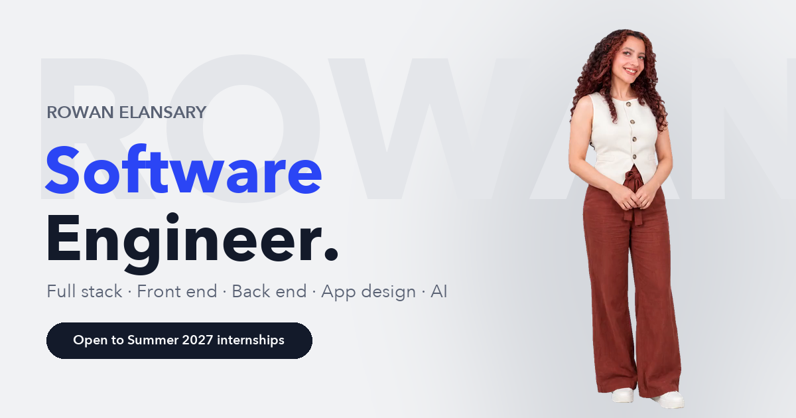

<div align="center">

<a href="https://rowanhosam.github.io/rowan-portfolio/"></a>

# Rowan's Access Pass

**An interactive portfolio for Rowan Elansary, software engineer and CS student at Fresno State.**

### [→ Visit the live site](https://rowanhosam.github.io/rowan-portfolio/)

Hiring for a specific role? Open the version built for it:
[Full stack](https://rowanhosam.github.io/rowan-portfolio/#recruiter-fullstack) ·
[Front end](https://rowanhosam.github.io/rowan-portfolio/#recruiter-frontend) ·
[Back end](https://rowanhosam.github.io/rowan-portfolio/#recruiter-backend) ·
[App / UX design](https://rowanhosam.github.io/rowan-portfolio/#recruiter-design) ·
[AI / ML](https://rowanhosam.github.io/rowan-portfolio/#recruiter-ai)

</div>

---

## What's inside

| | Feature | What it does |
|---|---|---|
| 🎫 | **Access gate** | Visitors pick *Recruiter*, *Engineer* or *Just curious*. Recruiters also pick what they're hiring for, and the page rearranges itself: section order, featured achievements, skills on the ID card, intro text and the rotating headline. |
| 🎥 | **Talking intro** | A full-body video introduction with the background removed, standing directly on the page, with word-by-word captions. Plays once on arrival; replay with sound on demand. |
| 💬 | **Ask me anything** | An AI assistant answers visitors' questions in the speech bubble, using only facts from my CV. Limited to 6 questions per visitor. |
| 🪪 | **Lanyard ID card** | Grab it, swing it, throw it. A physics-simulated lanyard with a 3D card that flips, catches the light with a holographic foil and clacks when it swings hard. |
| 🛂 | **Passport stamps** | Achievements as ink stamps: production apps, a 15-minute data pipeline, a People's Choice Award at the 2026 INSPIRE Convening for my research project Hibiki-AI, and more. Click one to read the entry. |
| ⌨️ | **Terminal** | Type `help`, `experience`, `projects` or `skills`, or just ask a question. Try `sudo`. |

## How it's built

**Front end: one static page, no framework, no build step**
- **Lanyard physics:** the strap is 12 points simulated with Verlet integration (gravity plus distance constraints solved iteratively), with a heavier point for the card. The card's angle follows the end of the strap, and its sideways speed spins it in 3D. Written from scratch, no physics library.
- **ID card:** real CR80 proportions (85.60 × 53.98 mm), CSS 3D flip, a holographic foil made from a masked `conic-gradient`, and sizes in container units so it scales cleanly.
- **Sound:** the clack is generated live with the Web Audio API (band-passed noise plus a short low tone). No audio files.
- **Transparent video:** VP9 WebM with alpha for Chrome and Firefox, HEVC with alpha for Safari, picked at runtime.
- **Role-based layout:** CSS `order` on a flex column plus a small `TRACKS` config. Shareable links like `#recruiter-backend` skip the gate.
- **Respects the visitor:** honours `prefers-reduced-motion`, works with a keyboard, and is responsive down to phone width.

**Back end: AI chat service (`api/`)**
- **FastAPI** service calling **Claude Haiku 5.5** through the official Anthropic Python SDK.
- Answers only from [`api/profile.md`](api/profile.md), in the first person, and declines anything off-topic.
- **Cost and abuse limits** with slowapi: 6 questions per visitor per day and 300 per day site-wide, which caps spend at about $0.10 a day. CORS allows only this site, and inputs are length-checked with Pydantic.
- **Tests** with pytest, with Claude faked so they cost nothing: answers, history handling, refusals, input validation, and both rate limits.
- Deployed on **Render** (free plan) from [`render.yaml`](render.yaml). The page shows a "waking up" message while the free server starts.

**Media pipeline**
- The intro is AI-generated with LongCat-Video-Avatar 1.5 from a photo and a voice recording.
- The background was removed frame by frame with **BiRefNet** (via rembg), then encoded with **ffmpeg**.

## Tech

`HTML` `CSS` `JavaScript` `Canvas` `Web Audio API` · `Python` `FastAPI` `Pydantic` `slowapi` `pytest` · `Claude API` · `ffmpeg` `rembg / BiRefNet` · `GitHub Pages` `Render`

## Project structure

```
index.html          the whole site: markup, styles and scripts
media/              intro video (WebM + HEVC with alpha), photos, link-preview image
api/main.py         chat API (FastAPI + Claude), limits and CORS
api/profile.md      the only facts the assistant may use
api/test_main.py    tests (Claude is faked)
render.yaml         Render deploy config
```

## Run it locally

```bash
python3 -m http.server 8080          # site at http://localhost:8080
```

```bash
cd api
pip install -r requirements.txt
ANTHROPIC_API_KEY=your-key uvicorn main:app --reload --port 8000   # chat API
ANTHROPIC_API_KEY=test pytest                                       # tests, no API calls
```

On `localhost` the page talks to the API on port 8000 automatically.

## Contact

**Rowan Elansary** · rowanelansary123@gmail.com · [LinkedIn](https://linkedin.com/in/rowan-elansary)
Open to a Summer 2027 internship (mid-May to late August) in full stack, front end, back end, app design or AI.
